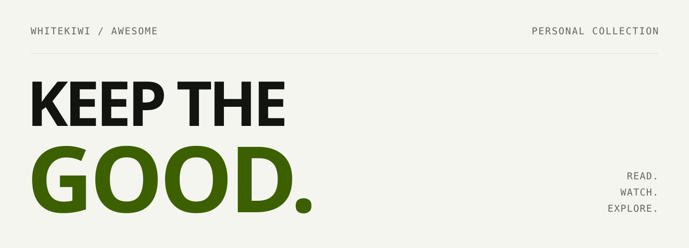

<picture>
  <source media="(prefers-color-scheme: dark)" srcset="assets/banner-dark.svg">
  <source media="(prefers-color-scheme: light)" srcset="assets/banner-light.svg">
  
</picture>

# 좋아서, 모아요.

마음에 든 글과 영상, 그리고 다시 꺼내 보고 싶은 발견들을 모읍니다.

[📖 아티클](#아티클) · [🎬 영상](#영상)

---

## 아티클

### [서버 모니터링 분석 가이드](https://kciter.so/posts/server-monitoring-analysis-guide/)

지연과 에러 같은 사용자 증상에서 출발해, 여러 지표를 함께 읽으며 장애 원인을 좁히는 방법.

kciter.so · 모니터링 / 트러블슈팅

### [켄트 벡과 함께하는 증강 코딩](https://velog.io/@qlgks1/Kent-Beck-Augmented-Coding)

개발자가 주도권을 잡고 테스트와 구조 개선을 병행하는 증강 코딩의 원칙과 실전 워크플로우.

정현우 · AI 코딩 / TDD

[아티클 전체 보기 →](collection/articles.md)

## 영상

### [AI 코딩, 기능 사이에 멈추는 법](https://www.youtube.com/watch?v=B-tCy2bKSMc)

켄트 벡의 강연을 바탕으로, 기능을 더하는 사이에 멈춰 코드의 구조와 변경 여지를 지키는 방법을 살펴봅니다.

AgentOS · 33분 · AI 코딩 / 설계

[영상 전체 보기 →](collection/videos.md)

---

함께 모으고 싶은 링크가 있다면 [여기에 남겨주세요 →](https://github.com/WhiteKiwi/awesome/issues/new?template=save-link.yml)

  Curated by <a href="https://github.com/WhiteKiwi">WhiteKiwi</a> · 목록과 메모는 <a href="LICENSE">CC0 1.0</a>

